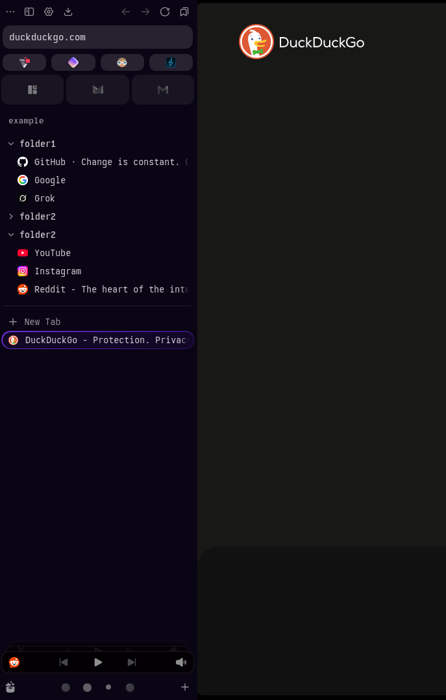

# Mod Zen Tweaks

A [Zen Browser](https://zen-browser.app/) mod that marks the active tab with frosted purple glass and leaves every other tab plain.

## What it changes

- **Active tab:** a dark violet, see-through background with a 10px backdrop blur. A thin 1.5px ring goes around it in a violet gradient (`#6a2fd1` → `#4b1fa3` → `#2e0f6e`). The ring is drawn as a mask, so the inside of the tab stays see-through.
- **Which tabs it covers:** standard tabs, container tabs, tabs in groups, Essentials, and multi-selected tabs. Glance tabs are left alone.
- **Essentials:** turns off Zen's own overlay on the active Essential tab, so the highlight shows through.
- **Container line:** hides the thin colored line that marks container tabs.
- **Sidebar:** gives the tab sidebar a darker, slightly see-through background (`rgba(12, 6, 24, 0.85)`).
- **Thin tabs:** tabs and folders are 28px tall with no gap between them (Zen's default is 36px with a 2px gap). It only changes Zen's own size variables, so collapsing folders still works. Essentials keep their size. To change the size, edit `--mod-tab-height` and `--mod-tab-gap` at the top of the compact section.
- **Folder arrow:** a small chevron replaces the folder icon. It points down when the folder is open and right when it's closed, and turns smoothly between the two. Its size is set by `--mod-folder-chevron`.

It works in both the compact (icons only) and full-size sidebar.

## Install

See the [main README](../README.md#install).
